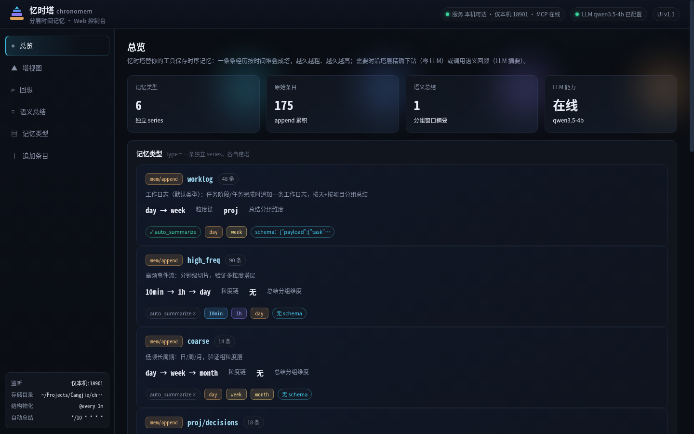
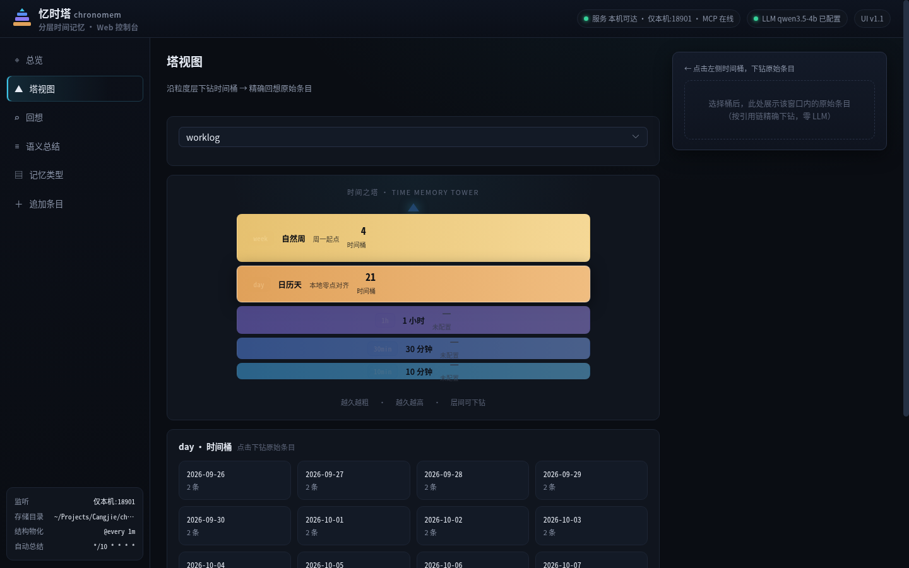
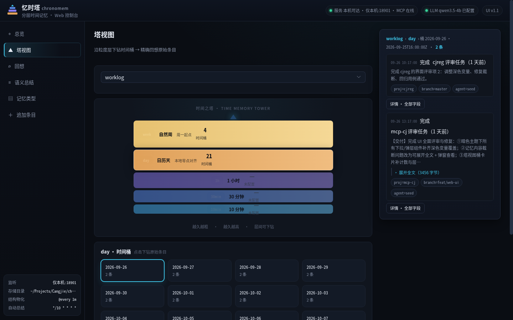
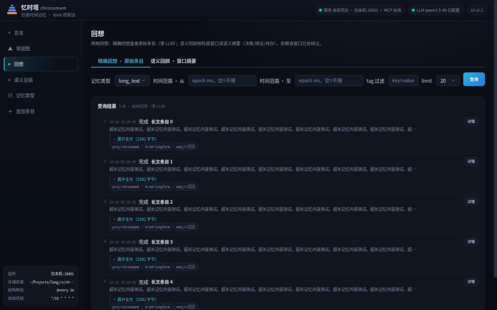
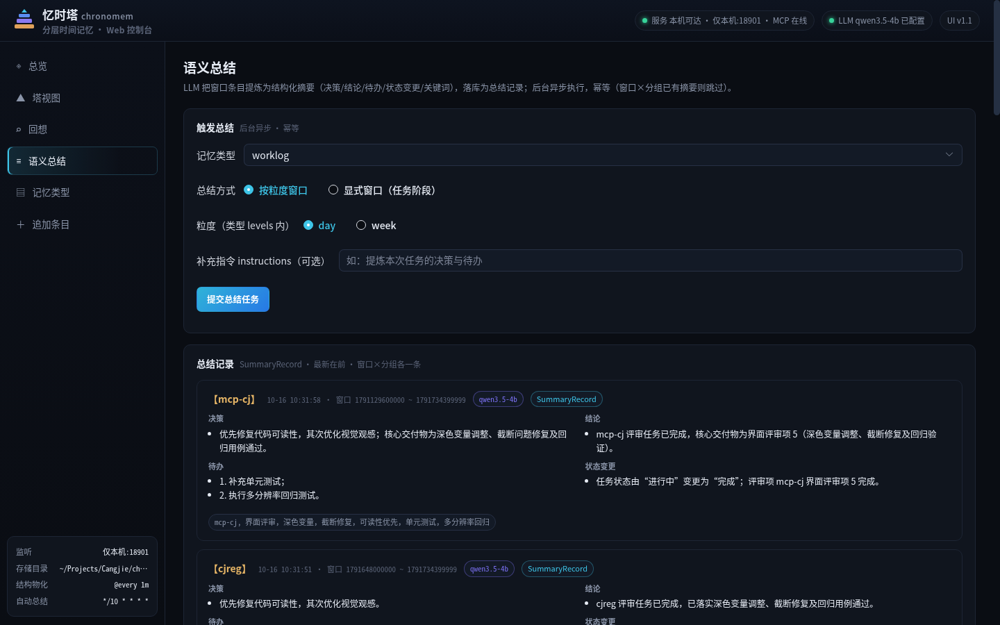
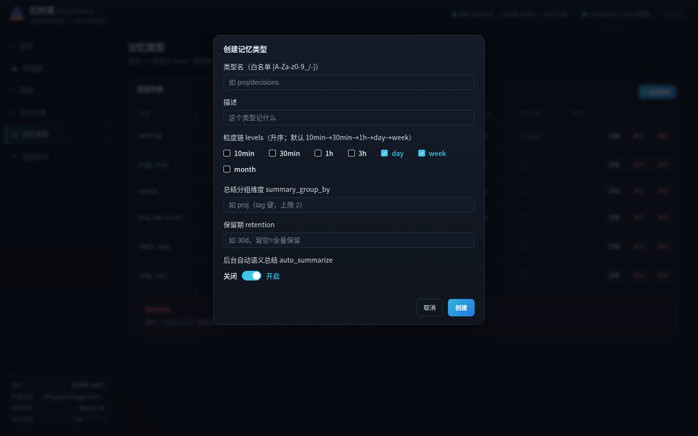
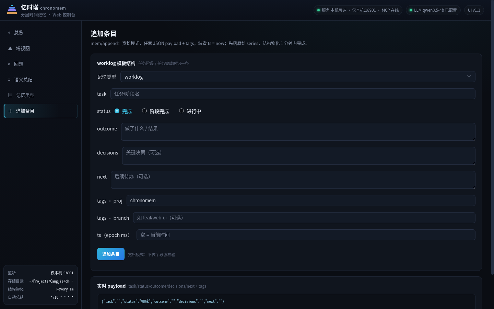
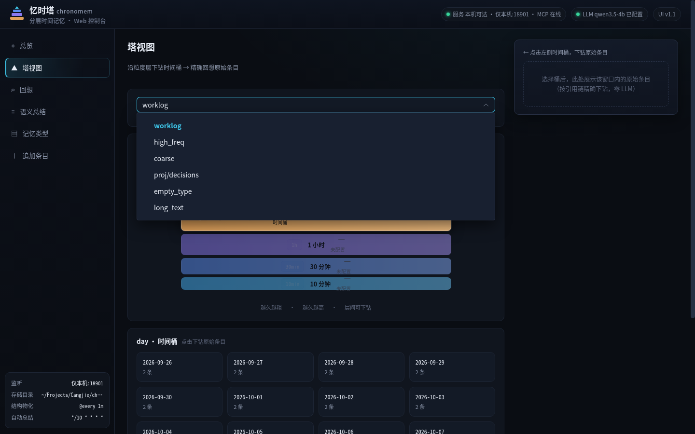
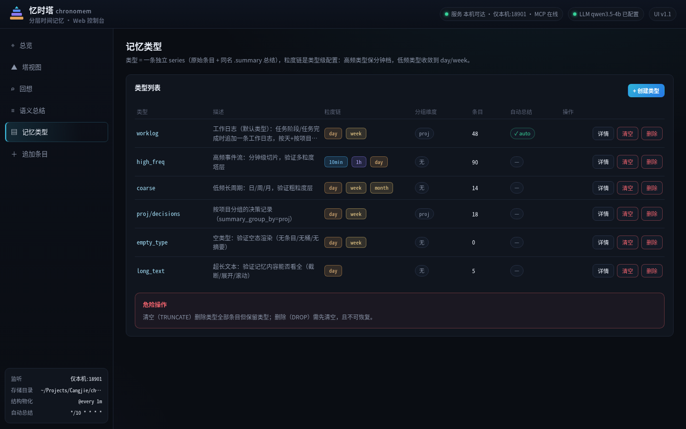

# 忆时塔（chronomem）

**中文** | [English](README.en.md)

分层时间记忆的 **MCP 服务**：替外部工具保存**时序记忆**（经历/事件），并按需提供**结构回想**（物化桶下钻，零 LLM）与**语义总结**（LLM 提炼，可递归）。

> 品牌：忆时塔（memento × time）。项目/包名：`chronomem`。
> 完整设计见 [`docs/design.md`](docs/design.md)。

## 论文

本项目的设计与评估各有一篇论文，均在 AiraXiv 上：

| 论文 | 内容 | 版本 | 评审 |
|---|---|---|---|
| [**Chronomem (忆时塔)：以 MCP 服务形态提供的时间分层外部记忆**](docs/paper/position-paper.zh.pdf)<br>AiraXiv [`2610.0035`](https://airaxiv.com/papers/view/2610.0035/) | 设计定位：两档回想的成本模型、递归总结、按类型的粒度链 | v2 | 6.6/10 |
| [**忆时塔实证评估：召回保持、压缩行为与递归总结的边界**](docs/paper/empirical-paper.zh.pdf)<br>AiraXiv [`2610.0045`](https://airaxiv.com/papers/view/2610.0045/) | 实证：容量断崖、递归步保真度由输入多样度决定、真实语料上什么存活 | v5 | 7.9/10 |

两篇都有**中英双版**（英文版为投稿正本）：定位论文 [中文](docs/paper/position-paper.zh.pdf) / [English](docs/paper/position-paper.pdf)，实证论文 [中文](docs/paper/empirical-paper.zh.pdf) / [English](docs/paper/empirical-paper.pdf)。Markdown 源在 [`docs/paper/`](docs/paper/)。

实证论文的每条量化主张都能追溯到本仓库里可重跑的脚本与归档结果（见 [`bench/results/`](bench/results/)）。其中几条结论是**反直觉的**，也是本项目后续设计要顾着的：

- **有界近因窗口的失效是断崖，不是衰减** —— 窗口内满分、越界归零，断崖位置随容量移动。所以「加大窗口」是移动边界，不是让边界变软。
- **压缩的承重件是「条目 → 取值」的对应关系** —— 保留配对的压缩器答对 100%，把取值转述掉的答对 0%，两者每问只差 11 个 token。**粗层不是细层的廉价版**：周摘要读得更多、答得更少。
- **递归总结的保真度取决于输入多样度，而非层级** —— 单天输入时该步常拒绝压缩（68% 长度比 ≥0.95），多天输入才真正压缩（0.54x）并丢掉约 40% 的数量。
- **真实语料上先丢「证据性数字」与因果机制，标识符活得最久** —— 而可复用规则最脆。若下游需要数字证据，**在提示词里要求总结器逐项保留取值**（实测可把可答性从 52.4% 找回到 100%，代价约 3.4 倍摘要长度）。

## 心智模型

- **塔 = 分层**：记忆按时间堆叠成塔，一层一个物化粒度（`10min → 30min → 1h → day → week`，**每类型可自定义**），越久越粗、越久越高；每层可沿引用链下钻到底层原始条目。
- **记忆类型 = 一条 series**：外部工具自定义「记忆类型」（= 消息类型），如 `worklog`、`proj/decisions`、`tool/errors`；各类型独立成库，互不干扰。
- **回想 vs 总结**（LLM 成本不同）：
  - **精确下钻**（`mem/recall mode=exact` + `mem/query`）：原始条目，语义保真、**零 LLM**。
  - **语义回顾**（`mem/recall mode=summary`）：时段摘要——前提是该时段**已总结过**（或 `summarize_on_miss=true` 现算），**有 LLM 成本**。
- **上下文恒定**：忆时塔只「存 + 查」，永不主动把内容塞回客户端上下文；由客户端自决。

## 特性

- ✅ 自定义记忆类型（宽松 schema，任意 JSON + tags）
- ✅ **开箱即用默认 `worklog` 类型**（启动自动播种，`CHRONOLOG_SEED_WORKLOG` 可关）
- ✅ 每类型自定义**粒度链 levels**（10min/30min/1h/3h/day/week/month 子集）
- ✅ **自然时间窗口（日历对齐）**：day=本地零点、week=周一起点、month=1 号零点（`CHRONOLOG_TIMEZONE`），非 epoch 锚定
- ✅ 结构回想：最近/时间范围/tag 过滤 + 物化桶**精确下钻**（零 LLM）
- ✅ 语义总结：窗口 → LLM 结构化摘要（决策/结论/待办/状态变更/关键词）→ 落 `SummaryRecord`，**可递归再总结**
- ✅ **定时自动总结**（cron-cj 驱动，默认 `*/10 * * * *`）：opt-in 类型自动长摘要，带闭合+沉降+幂等+每轮上限护栏
- ✅ 任务阶段总结：`from/to` 显式窗口任意不规则时段
- ✅ 后台结构物化（cron-cj，默认 `@every 1m`，零 LLM，幂等）
- ✅ 仅 streamable HTTP（2025-11-25 session），多客户端共享同一记忆库

## 构建与运行

```bash
eval "$(cjvs env bash)" && eval "$(cjvs stdx-env bash)"
cjpm build -j 16

# 运行（常驻守护进程）
CHRONOLOG_DIR=~/.chronolog CHRONOLOG_PORT=8900 \
LLM_BASE_URL=... LLM_API_KEY=... LLM_MODEL=... \
./target/release/bin/chronomem.cli serve
```

| 环境变量 | 默认 | 说明 |
|---|---|---|
| `CHRONOLOG_DIR` | `~/.chronolog` | 存储根目录（内含 `tsdb/`） |
| `CHRONOLOG_ADDR` | `127.0.0.1` | 绑定地址（本地安全；容器/远程用 `0.0.0.0`） |
| `CHRONOLOG_PORT` | `8900` | HTTP 监听端口 |
| `CHRONOLOG_TIMEZONE` | 本地时区 | 自然窗口时区（IANA id，如 `Asia/Shanghai`） |
| `CHRONOLOG_MATERIALIZE_CRON` | `@every 1m` | 结构物化 cron |
| `CHRONOLOG_SUMMARY_CRON` | `*/10 * * * *` | 自动语义总结 cron |
| `CHRONOLOG_SUMMARY_MAX_PER_RUN` | `5` | 每轮自动总结次数上限 |
| `CHRONOLOG_SUMMARY_SETTLE` | `600000` | 窗口闭合沉降期（毫秒） |
| `CHRONOLOG_SUMMARY_NO_THINK` | `true` | 总结时透传 `chat_template_kwargs.enable_thinking=false` 关掉推理模型的思考。**仅对 vLLM/llama.cpp/SGLang 这类 OpenAI 兼容端点有效**；用云端严格 OpenAI API 时请置 `false` |
| `CHRONOLOG_SUMMARY_MAX_TOKENS` | `4096` | 单次总结的输出上限。本地慢端点建议收紧；云端/强硬件可放宽 |
| `CHRONOLOG_SUMMARY_CONTEXT_TOKENS` | `32768` | **端点给该模型分配的上下文**（llama.cpp/llama-swap 的 `--ctx-size`）。客户端据此算输入预算：装得下一次直连，装不下按条目边界切块 + 聚合。实测 `qwen3.5-9b-mtp`=32768、`qwen3.5-4b`/`2b`=131072——**换模型必须同步改这里**，否则会撞 `exceeds the available context size` |
| `CHRONOLOG_SUMMARY_SAFETY_TOKENS` | `1024` | 输入预算余量（模板/行前缀/估算误差） |
| `CHRONOLOG_SUMMARY_BYTES_PER_TOKEN` | `2` | UTF-8 字节/token 的**保守**估值（实测 3.01，取 2 = 低估容量、提前切块的安全方向） |
| `CHRONOLOG_SUMMARY_MAX_CALLS` | `8` | 单个总结任务的 LLM 调用上限（切块数 + 1 次聚合） |
| `CHRONOLOG_SUMMARY_CALL_TOKENS` | `40000` | **单次调用**的输入上限。上下文大 ≠ 一次调用就能做那么大：实测 4b prefill ~317 tok/s，205K 字节的块（≈68K token）会撞 `readTimeout`（300s）。默认 40K ≈ 2 分钟 prefill |
| `CHRONOLOG_SUMMARY_READ_TIMEOUT` | `300` | llm_api 单次读超时（秒）。端点确实需要长 prefill 时可调大；更推荐把 `CALL_TOKENS` 调小（切块更细） |
| `CHRONOLOG_SUMMARY_MAX_ATTEMPTS` | `3` | 同一窗口连续失败多少次后停止自动重试（默认退避 20 分钟 → 60 分钟 → 放弃；防"每 10 分钟白烧"） |
| `CHRONOLOG_SEED_WORKLOG` | `true` | 启动自动创建默认 `worklog` 类型（可关） |
| `LLM_BASE_URL` | 无 | OpenAI 兼容端点（仅 summarize 需要） |
| `LLM_API_KEY` | 无 | API Key |
| `LLM_MODEL` | 无 | 默认模型 |
| `LLM_PROVIDER` | `openai` | `openai` / `anthropic` / `ollama` |

> 未配置 LLM 时：结构回想/存储照常可用，`mem/summarize` 返回明确错误。

## Web 控制台（内嵌，cjxt）

服务启动时自动内嵌 **忆时塔 Web 控制台**（[cjxt](https://ystyle.top/cjxt) 服务端驱动 UI，深色「时间塔」主题）：
页面与 MCP 服务同进程、**同端口**——页面/静态资源/WebSocket 占根路径，MCP 挂 `/mcp`；页面直接调服务，无 HTTP 开销。

| 环境变量 | 默认 | 说明 |
|---|---|---|
| `CHRONOLOG_UI_ENABLED` | `true` | 设为 `false` 则只跑 MCP |

```bash
CHRONOLOG_DIR=~/.chronolog CHRONOLOG_PORT=8900 ./target/release/bin/chronomem.cli serve
# 浏览器打开 http://127.0.0.1:8900        （Web 控制台）
#         http://127.0.0.1:8900/mcp      （MCP 端点）
```

**页面**：总览（统计/类型卡/最近条目流）· 塔视图（粒度链分层可视化 → 时间桶 → 精确下钻原始条目）· 回想（精确回想 / 语义回顾·窗口摘要双模式）· 语义总结（后台任务触发 + SummaryRecord 列表）· 记忆类型（创建/详情/清空/删除守卫）· 追加条目（worklog 模板 + 实时 JSON 预览）。

### 界面一览

> 以下截图取自隔离实例（独立数据目录与端口）的**测试数据**，非真实记忆内容；
> 重新生成：`python3 docs/ui/scripts/readme_shots.py`。

**总览** — 记忆类型 / 原始条目 / 语义总结规模，类型卡片直接展示粒度链与分组维度：



**塔视图** — 粒度链分层可视化（越久越粗、越久越高），点桶即下钻；完整塔身与当日时间桶：



<details>
<summary>塔视图 · 下钻到原始条目</summary>

右侧为引用链精确下钻的原始条目（零 LLM），长内容给「展开全文」出口：



</details>

**回想** — 精确回想直查原始条目；长 outcome 不再截断后无处可看，每条都带「展开全文（N 字节）」与「详情 · 全部字段」：



**语义总结** — 后台异步触发窗口总结，SummaryRecord 按「决策 / 结论 / 待办 / 状态变更 / 关键词」结构化展示：



**记忆类型** — 类型即一条独立 series；创建时可选粒度链，销毁走「清空（TRUNCATE）→ 删除（DROP）」两步守卫：



**追加条目** — worklog 模板表单 + 实时 payload 预览，宽松模式不做字段强校验：



<details>
<summary>更多截图（类型下拉 / 类型列表）</summary>

类型下拉在深色主题下的适配（选项完整可读，不被压成单字母）：



类型列表：条目数、粒度链、分组维度、自动总结状态一览：



</details>

## Docker 部署

> 镜像 = 产物打包：宿主工具链编译（`cjpm build`，`--static` 无 libcangjie-runtime 依赖）→ COPY 进镜像，镜像内不重编译。
> 基础镜像 `archlinux:latest`（与宿主 glibc 一致）+ `liburing`（badgercj io_uring）+ `tzdata`（自然窗口）+ `ca-certificates`（LLM TLS）+ `curl`（健康检查）。

```bash
# 1. 构建产物
eval "$(cjvs env bash)" && eval "$(cjvs stdx-env bash)"
cjpm build -j 16

# 2. 部署（~/docker/chronomem/docker-compose.yml）
cd ~/docker/chronomem
docker compose up -d --build
```

**数据卷**：宿主 `~/docker/chronomem/data`（compose 栈的 `./data`）↔ 容器 `/home/app/.chronolog`（tsdb 时序库 + 类型注册表；容器销毁不丢数据）。

**生产注意**：
- **先建好数据目录再 up**：`mkdir -p ~/docker/chronomem/data && chown -R 1000:1000 ~/docker/chronomem/data`（与容器内 `app` uid 1000 对齐；docker 自动建缺失目录时属主会是 root/nobody，届时用 `docker run --rm --user root -v .../data:/data chronomem:latest chown -R 1000:1000 /data` 修正）。
- 容器内需 `CHRONOLOG_ADDR=0.0.0.0`（docker 端口映射走容器外部 IP，绑 127.0.0.1 会连不上）。
- LLM 环境变量填在 `~/docker/chronomem/.env`（`LLM_BASE_URL` / `LLM_API_KEY` / `LLM_MODEL`），不填则 summarize 报「未配置 LLM」，其余功能正常。
- **MCP 与 Web 控制台同端口**：容器只暴露 **8900**，UI 占根路径、MCP 挂 `/mcp`。
- 镜像带 `STOPSIGNAL SIGTERM` 与 `HEALTHCHECK`（探根路径）；服务在退出时 flush memtable 落盘，compose 里配 `stop_grace_period` 给它时间。
- 更新 = `cd ~/docker/chronomem && docker compose up -d --build`（数据卷 `./data` 不动，零丢失）。

## 客户端接入

任意支持 Streamable HTTP 的 MCP 客户端（opencode / Cherry Studio / Inspector / dsh / Claude Desktop 等）：

```jsonc
// opencode.json
{ "mcp": { "chronomem": { "type": "remote", "url": "http://127.0.0.1:8900" } } }
```

MCP Inspector：

```bash
npx @modelcontextprotocol/inspector --url http://127.0.0.1:8900
```

## 工具参考

| 工具 | 作用 |
|---|---|
| `mem/type_create` | 创建记忆类型（`name` 必填；`levels`? 粒度链；`auto_summarize`? 后台自动总结；`summary_levels`? 自动总结粒度；`description`? `schema`? `retention`?） |
| `mem/list_types` | 类型列表（name/描述/条目数/粒度链） |
| `mem/type_info` | 单类型详情（meta + 条目数 + 各粒度物化桶数） |
| `mem/truncate` | 清空类型全部条目（原始 + 总结，TRUNCATE 语义；保留类型） |
| `mem/type_delete` | 删除类型（DROP 语义；**守卫：原始 + 总结序列必须为空**，先 `mem/truncate`） |
| `mem/append` | 追加条目（`type` + `payload` 必填；`tags`? `ts`?） |
| `mem/query` | 结构回想：`from`? `to`? `limit`? `tag`?（多条件语法见「标签过滤」） |
| `mem/recall` | `mode=exact` 下钻原始（零 LLM）/ `mode=summary` 语义回顾；`granularity` 须在类型 levels 内；`summarize_on_miss`? |
| `mem/buckets` | 列某粒度物化桶（发现可用窗口） |
| `mem/summarize` | **语义总结（后台异步）**：提交总结任务立即返回 `job_id`，LLM 在后台线程执行，**不阻塞任何其它请求**；`from/to`（任务阶段）或 `granularity`（按粒度）；`instructions`? `store`?（默认 true 落库） |
| `mem/summarize_status` | 查后台总结任务状态（`job_id`；pending/running/done/failed；`store=false` 时返回结果文本） |
| `mem/summaries` | 查总结记录（最新在前） |

## 标签过滤语法（`mem/query` 的 `tag`）

| 写法 | 含义 |
|---|---|
| `proj=chronomem` | 单条件等值（与旧版完全一致） |
| `proj=chronomem role=user` | 空格分隔 = **多条件 AND** |
| `status=todo,done` | 逗号分隔 = **同 tag 多值 IN**（OR） |
| `status=todo,done room=r1` | IN 与 AND 组合 |

语义要点：

- **条件间一律 AND**，没有 OR 运算符（需要 OR 时用同 tag 多值 IN 表达最常见的场景）；
- **同一 tag 写两遍 = 两个 AND 条件**，必然无交集——不会被悄悄合并成 IN（避免歧义）；
- **语法错误一律报错**（缺 `=`、空键、空值、`status=todo,` 这种尾部空项）。这是刻意的：
  静默降级为「无过滤」会把「查某个项目」变成「查全部条目」，返回大量无关数据而调用方毫无察觉。

## 示例：工作日志

> `worklog` 类型**开箱即用**：服务启动时自动创建（`levels: [day, week]` + `auto_summarize: true`），无需手动建类型。

```text
# 干活时随手记（可能一天 1 条，也可能一小时好几条）
mem/append { type: "worklog", payload: { "task": "拆分忆时塔设计", "status": "完成", "outcome": "..." }, tags: { "proj": "chronomem" } }

# 后台自动总结：day/week 窗口闭合后自动长摘要（默认 */10 * * * * 检查）
# 任务阶段结束 → 按阶段手动总结（不规则窗口；提交后台任务，立即返回，LLM 后台跑）
mem/summarize { type: "worklog", from: <任务开始>, to: <任务结束>, instructions: "提炼本次任务的决策与待办" }
mem/summarize_status { job_id: <mem/summarize 返回的 job_id> }   # 查任务状态；完成后 summaries/recall 可取摘要

# 回想
mem/query  { type: "worklog", tag: "proj=chronomem" }          # 结构回想（零 LLM）
mem/query  { type: "worklog", tag: "proj=chronomem role=user" } # 多条件 AND
mem/query  { type: "worklog", tag: "status=todo,done" }        # 同 tag 多值 IN
mem/recall { type: "worklog", granularity: "day" }             # 精确下钻当天原始条目
mem/recall { type: "worklog", granularity: "day", mode: "summary" }  # 语义回顾（当天摘要）
```

## 测试

```bash
cjpm test -j 16 --no-progress
```

覆盖：Timeline 物化桶链/下钻/校验、类型注册表/持久化恢复、Summarizer（fake Provider）、全部 handler、HTTP 全链路 e2e。

## 依赖

| 依赖 | 用途 |
|---|---|
| [`mcp`](../mcp-cj) | MCP 协议框架（streamable HTTP） |
| [`tsdb`](../tsdb-cj) | 时序存储（series + 物化桶 + drillDown） |
| [`llm_api`](../llm_api) | 自研薄层 LLM REST 库（OpenAI/Anthropic/Ollama） |
| [`cron`](../cron-cj) | 定时调度（结构物化 + 自动语义总结） |
| `jsonvalue` | 工具参数 / 动态字段 |

## License

MIT
